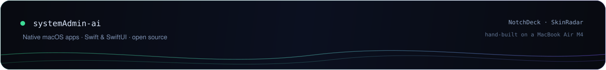

<div align="center">



<br/>


<br/>

[](https://github.com/systemAdmin-ai)

**English** · [Русский](README.ru.md)

</div>

## Ahoy 👋

I write **native macOS apps in Swift** — no Electron, no wrappers, just AppKit and SwiftUI talking to the system directly.

My main project is **[NotchDeck](#-notchdeck--a-control-center-in-the-notch)** — a neon control center that lives in the MacBook notch. I built it, I ship it, I keep it alive. Right now I'm also building **[SkinRadar](#-skinradar--cheaper-cs2-skins-in-development)**, a search engine that hunts for cheaper CS2 skins across marketplaces.

<table>
<tr>
<td width="50%"></td>
<td width="50%"></td>
</tr>
</table>

---

## ⚓ NotchDeck — a control center in the notch

The strip of black plastic at the top of a MacBook is dead space. NotchDeck turns it into a live panel: system metrics, media, quick notes, screen recording — one click or one hover away.

| | |
|---|---|
| **What it is** | Native SwiftUI app for Apple Silicon MacBooks, macOS 14+ |
| **Status** | Actively maintained — v2.2.0 is out, releases ship often |
| **License** | MIT |
| **Under the hood** | Swift, SwiftUI, AppKit, IOKit, ScreenCaptureKit, a Homebrew cask, signed local builds |

**What's inside**

- 📊 Live system metrics at a glance, no menu bar clutter
- 🎛 App shortcuts, task profiles and eight neon themes
- ⌨️ **Keyboard mode** — Windows keyboard habits on a Mac keyboard (left Ctrl → Command, Alt+Shift toggle)
- 🎥 Screen recording and screenshots into your own folder
- 🎵 Compact now-playing, quick notes, charging glow, low-battery pulse, configurable alerts
- 🌗 Light, dark and auto materials that follow the wallpaper

```bash
brew install --cask systemAdmin-ai/notchdeck/notchdeck
```

Every release ships `SHA256SUMS.txt` and a signed checksum — the build can be verified with `shasum -a 256 -c SHA256SUMS.txt` or `gh attestation verify`.

<div align="center">

[](https://github.com/systemAdmin-ai/NotchDeck/releases/latest/download/NotchDeck.dmg)
[](https://systemAdmin-ai.github.io/NotchDeck/)
[](https://systemAdmin-ai.github.io/NotchDeck/demo.html)
[](https://github.com/systemAdmin-ai/NotchDeck)

</div>

---

## 🛰 SkinRadar — cheaper CS2 skins, in development

CS2 skins are traded on five marketplaces at once, and the spread between them is where the money hides. SkinRadar puts them side by side: one query, every listing, the cheapest one on top.

- 🔎 One search across five CS2 marketplaces
- 💸 Price spread, marketplace fees and the cheapest listing per skin
- 📉 Watchlist and price history for the skins you actually trade
- 🔐 **Steam password is never requested** — user passwords are stored only as a PBKDF2-SHA256 hash

Static site and account area are live; the search core is being rebuilt. It's an early preview, expect rough edges.

<div align="center">

[](https://systemAdmin-ai.github.io/skinradar-site/)
[](https://systemAdmin-ai.github.io/skinradar-site/)

</div>

---

## 🧰 Toolbox

<div align="center">


</div>

---

## 📊 By the numbers

<div align="center">

<table>
<tr>
<td width="50%"></td>
<td width="50%"></td>
</tr>
</table>


</div>

> Cards on the left are generated from the GitHub API by [`scripts/gen_stats.py`](scripts/gen_stats.py) and refreshed nightly — no third-party image services.

---

## 🐍 Contributions

<div align="center">

<picture>
  <source media="(prefers-color-scheme: dark)" srcset="https://raw.githubusercontent.com/systemAdmin-ai/systemAdmin-ai/output/github-snake-dark.svg"/>
  <source media="(prefers-color-scheme: light)" srcset="https://raw.githubusercontent.com/systemAdmin-ai/systemAdmin-ai/output/github-snake.svg"/>
  
</picture>

</div>

---

<div align="center">



<sub>Build things that feel native. Ship them in the open.</sub>

</div>
