<div align="center">


<br/>


<br/>

[English](README.md) · **Русский**

</div>

## Привет 👋

Пишу **нативные приложения для macOS на Swift** — без Electron и обёрток, только AppKit и SwiftUI, работающие с системой напрямую.

Главный проект — **[NotchDeck](#-notchdeck--центр-управления-в-чёлке)**: центр управления, который живёт прямо в чёлке MacBook. Я его разработал и продолжаю поддерживать. Параллельно делаю **[SkinRadar](#-skinradar--дешёвые-скины-cs2-в-разработке)** — поиск дешёвых скинов CS2 по торговым площадкам.

<table>
<tr>
<td width="50%"></td>
<td width="50%"></td>
</tr>
</table>

---

## ⚓ NotchDeck — центр управления в чёлке

Полоска чёрного пластика в верхней части MacBook обычно простаивает. NotchDeck превращает её в живую панель: системные метрики, медиа, быстрые заметки и запись экрана — в одном клике или наведении.

| | |
|---|---|
| **Что это** | Нативное приложение на SwiftUI для Apple Silicon, macOS 14+ |
| **Статус** | Активно поддерживается — вышел 2.2.0, релизы выходят часто |
| **Лицензия** | MIT |
| **Внутри** | Swift, SwiftUI, AppKit, IOKit, ScreenCaptureKit, Homebrew cask, локальная подпись сборок |

**Что умеет**

- 📊 Системные метрики в реальном времени, без засорения строки меню
- 🎛 Ярлыки приложений, профили задач и восемь неоновых тем
- ⌨️ **Режим клавиатуры** — привычки Windows-клавиатуры на Mac (левый Ctrl → Command, переключение Alt+Shift)
- 🎥 Запись экрана и снимки в собственную папку
- 🎵 Компактный now-playing, быстрые заметки, подсветка при зарядке, пульс низкого заряда, настраиваемые оповещения
- 🌗 Светлые, тёмные и автоматические материалы, подстраивающиеся под обои

```bash
brew install --cask systemAdmin-ai/notchdeck/notchdeck
```

К каждому релизу прилагается `SHA256SUMS.txt` и подписанная контрольная сумма — сборку можно проверить через `shasum -a 256 -c SHA256SUMS.txt` или `gh attestation verify`.

<div align="center">

[](https://github.com/systemAdmin-ai/NotchDeck/releases/latest/download/NotchDeck.dmg)
[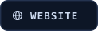](https://systemAdmin-ai.github.io/NotchDeck/)
[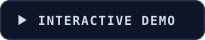](https://systemAdmin-ai.github.io/NotchDeck/demo.html)
[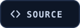](https://github.com/systemAdmin-ai/NotchDeck)

</div>

---

## 🛰 SkinRadar — дешёвые скины CS2, в разработке

Скины CS2 торгуются сразу на пяти площадках, и разница в цене между ними — как раз то, на чём зарабатывают. SkinRadar ставит их рядом: один запрос, все предложения, самое дешёвое сверху.

- 🔎 Один поиск по пяти площадкам CS2
- 💸 Разброс цен, комиссии площадок и самое выгодное предложение по скину
- 📉 Список отслеживания и история цен по нужным скинам
- 🔐 **Пароль Steam не запрашивается** — пароли пользователей хранятся только как хеш PBKDF2-SHA256

Сайт и личный кабинет уже работают, поисковое ядро переписывается. Это ранняя версия — шероховатости возможны.

<div align="center">

[](https://systemAdmin-ai.github.io/skinradar-site/)

<sub>статус — в разработке</sub>

</div>

---

## 🧰 Инструменты

<div align="center">

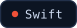


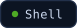
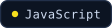


</div>

---

## 📊 В цифрах

<div align="center">

<table>
<tr>
<td width="50%"></td>
<td width="50%"></td>
</tr>
</table>


</div>

> Все карточки здесь собирает [`scripts/gen_stats.py`](scripts/gen_stats.py) из GitHub API, обновление — каждую ночь. Бейджи, кнопки и строка с набором текста — тоже локальные SVG, ничего не зависит от сторонних сервисов картинок.

---

## 🐍 Вклады

<div align="center">

<picture>
  <source media="(prefers-color-scheme: dark)" srcset="https://raw.githubusercontent.com/systemAdmin-ai/systemAdmin-ai/output/github-snake-dark.svg"/>
  <source media="(prefers-color-scheme: light)" srcset="https://raw.githubusercontent.com/systemAdmin-ai/systemAdmin-ai/output/github-snake.svg"/>
  
</picture>

</div>

---

<div align="center">

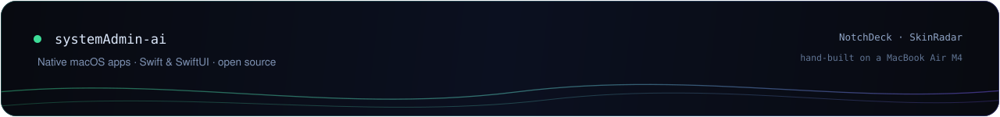

<sub>Делать вещи, которые ощущаются нативными. И выпускать их в открытом коде.</sub>

</div>
